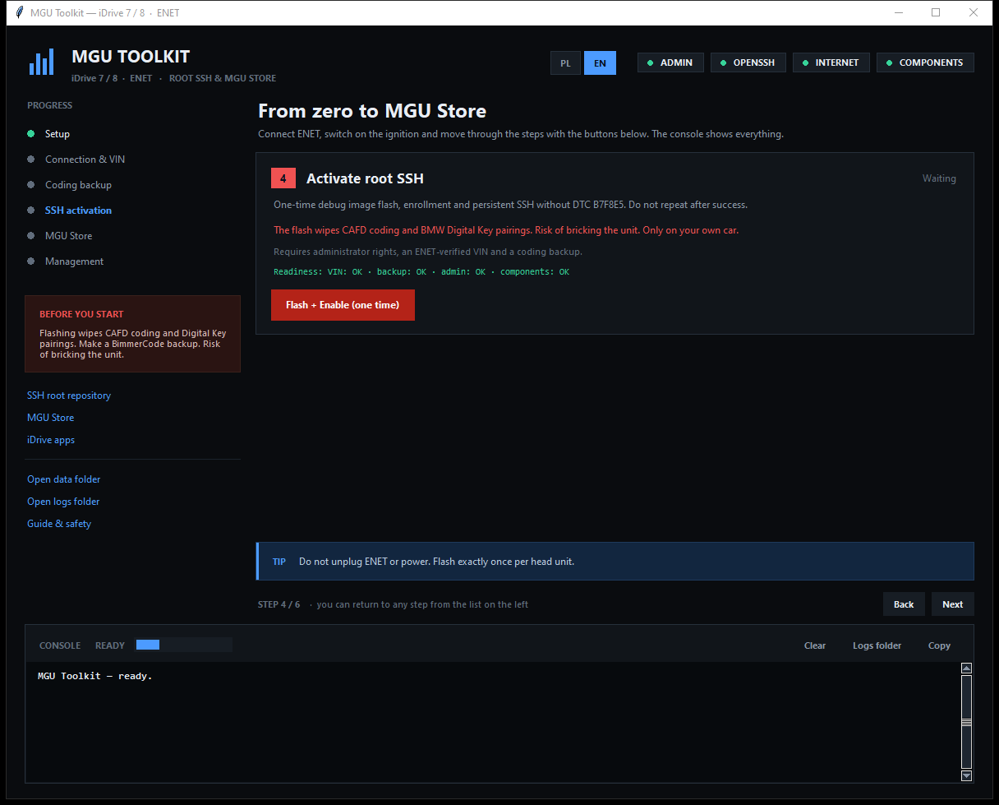
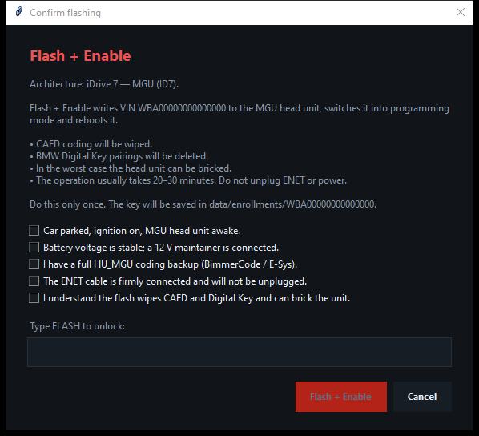

# MGU Toolkit

**One-click, safety-first installer for root SSH and MGU Store on BMW iDrive 7 / 8 (MGU) over ENET.**

> **Warning:** this is an unofficial tool, not affiliated with BMW AG. Flashing can brick the head unit, wipe CAFD coding and delete BMW Digital Key pairings. Use it only on your own car, at your own risk.

| Polish UI | English UI |
| --- | --- |
|  |  |



---

## What is it?

MGU Toolkit is a Python/Tkinter GUI that wraps two official open-source projects:

- [idrive7-8-ssh-root](https://github.com/cauliflowermossgrape/idrive7-8-ssh-root) — enables root SSH on BMW MGU head units over ENET: debug image flash, enrollment and persistent SSH without the B7F8E5 DTC.
- [mgu-store](https://github.com/robertnisipeanu/mgu-store) — the app store for iDrive 7/8: Store, updater, deploy tool, renderer and internet uplink.

The app **does not reimplement flashing**. It runs the official tools, keeps the order, checks preconditions and enforces safety gates. That makes the process shorter and harder to break with a typo.

## Who is it for?

- BMW owners with iDrive 7 (MGU) or iDrive 8 (BDC3 / BCP) who want to install root SSH and MGU Store themselves.
- People who want Waze or Google Maps on the instrument cluster, engine data, 0–100 km/h timers and other [idrive-apps](https://github.com/robertnisipeanu/idrive-apps).
- People who understand the risk and have an ENET cable, a Windows/macOS/Linux laptop, Python 3.9+ and BimmerCode/E-Sys for coding backups.

It is **not** for iDrive 6 and older (NBT/EVO) — the upstream tool refuses them. It is also not a replacement for BimmerCode or E-Sys: coding still has to be backed up and restored with a proper coding tool.

## Features

- One-click component setup: repository download, isolated `.venv`, `cryptography` and the MGU Store installer.
- ENET VIN detection over UDP discovery.
- **The VIN must be verified over ENET** — typing it manually is not enough.
- **A verified read-only coding backup is mandatory** (`UDS 0x22`, no writes) and is bound to the VIN.
- A five-point safety checklist plus a typed `FLASH` confirmation (`FLASH-ID8` for iDrive 8).
- One-time `Flash + Enable` with `--persist` (persistent SSH, no B7F8E5 DTC).
- Re-flashing is blocked by a saved key or VIN history.
- Automatic post-flash SSH login test; MGU Store is blocked if SSH is unverified or disabled.
- Repair tools: `enable` (repair without flashing), `disable`, `fix-key` (same safety gates), MGU restart, SSH test and unit status.
- Live PL/EN language switch; the choice is persisted.
- Session log on disk and a coloured console.
- The window cannot be closed during an operation.
- Actions are blocked when Python, the virtual environment, administrator rights or components are missing.

## Requirements

- Windows 10/11 (primary target; macOS/Linux can be run manually).
- Python 3.9+ with Tkinter — the python.org Windows installer includes it.
- OpenSSH client (`ssh -V`).
- ENET cable; a USB-C/USB Ethernet adapter if the laptop has no Ethernet port.
- Internet for the first setup and the MGU Store install.
- Administrator/root rights.
- Car parked, ignition on, stable 12 V (a battery maintainer is recommended).
- BimmerCode or E-Sys for the HU_MGU coding backup and restore.

## Quick start

```powershell
git clone https://github.com/Xayanix/idrive7-mgu-installer.git
cd idrive7-mgu-installer
```

1. Run `Start MGU Toolkit (Admin).bat` (UAC) or `py run.py`.
2. Step 1: **Prepare components**.
3. Step 2: Connect ENET, switch on the ignition, click **Detect VIN** and check the VIN.
4. Step 3: Make the **read-only coding backup** and also export HU_MGU coding with BimmerCode.
5. Step 4: **Flash + Enable** — exactly once.
6. Step 5: **Install MGU Store**, then restart the head unit.
7. Step 6: Check status, repair SSH or disable access.

## How it works

- `mgu_toolkit/app.py` — GUI, safety gates, worker threads, console.
- `mgu_toolkit/repos.py` — repository downloads, virtual environment, dependencies, VIN detection, restart and SSH test.
- `mgu_toolkit/proc.py` — process streaming without freezing the UI.
- `mgu_toolkit/checks.py` — administrator, OpenSSH, internet and component checks.
- `mgu_toolkit/config.py` — paths and settings.
- `mgu_toolkit/i18n.py` — English/Polish translations.
- `run.py` — entry point.
- `Start MGU Toolkit (Admin).bat` — Windows launcher with UAC elevation.
- `mgu-workspace/` — generated at runtime: repositories, `.venv`, logs, config, keys and backups. It is git-ignored and never committed.

Nothing sensitive is uploaded to the repository: SSH keys, VINs, coding backups and logs stay local.

## Safety model

The app enforces the following:

1. **ENET-verified VIN** — the VIN must be read from the car's gateway in the current session and match the entered VIN.
2. **Coding backup** — flashing is blocked without a successful read-only backup for that VIN. The backup folder must contain `SHA256SUMS` and `coding_MGU.txt`.
3. **Safety checklist** — before flashing you must confirm: car parked and awake, stable 12 V, full HU_MGU backup, firmly connected ENET, risk understood.
4. **Typed confirmation** — you must type `FLASH` (`FLASH-ID8` for iDrive 8).
5. **One flash only** — a second flash is blocked by a saved key or VIN history.
6. **Post-flash verification** — SSH login is tested automatically; MGU Store will not start if SSH is not working.
7. **`fix-key` is a flash too** — it requires an ENET-verified VIN, coding backup, the checklist and typed `FIX`.
8. **Session log** — every operation and tool response is written to `mgu-workspace/logs/session-*.log`.
9. **Close protection** — the window cannot be closed while an operation is running.
10. **Environment guards** — missing Python, venv, admin rights or components block actions instead of running with invalid state.

What the app cannot protect against: power loss, a loose cable, the wrong architecture, skipping the BimmerCode backup, or a head unit that was already in a bad state. Hardware risk remains with the user.

## After the flash

- The iDrive screen may go dark, turn blue or the unit may reboot. This is normal.
- If settings return to factory defaults, restore coding with BimmerCode; if problems remain, recode HU_MGU with E-Sys (VO coding). **Do not re-flash.**
- BMW Digital Key must be paired again.
- If SSH stops answering, use **Repair SSH (enable)**.
- If port 22 is open but root login is refused, use **Fix key (fix-key)**.

## Troubleshooting

**No ENET gateway** — check the cable and adapter, run the app as administrator, switch on the ignition and wake the MGU (3 quick START/STOP presses). Make sure Windows sees a `169.254.x.x` address on the ENET adapter.

**VIN is not reported** — the app intentionally refuses to flash without an ENET-verified VIN. If the gateway does not report one, use the official CLI only if you understand the risk.

**SSH does not work after a successful flash** — use `fix-key`, then test SSH login again.

**The Store tile is missing** — restart the head unit from step 5 or hold the volume knob for about 25 s.

**Python is not found** — install Python 3.9+ from python.org with `Add Python to PATH`, then check `py -3 --version`.

**Antivirus blocks PowerShell** — the MGU Store installer is downloaded from the official repository and verified against `SHA256SUMS`. You can inspect it in `mgu-workspace/tools/` before running.

## FAQ

**Does it work with iDrive 8?** The upstream tool supports ID8-BDC3 and ID8-BCP, but MGU Store is tested on ID8 mainly in an emulator. Treat it as experimental.

**Does it work with iDrive 6 / NBT / EVO?** No. The tool refuses those units.

**Does the flash wipe coding?** Yes, CAFD coding is wiped. That is why a backup is mandatory.

**Does it delete Digital Key?** Yes, the pairing is removed and must be set up again.

**Can it be undone?** `disable` turns SSH off but does not remove the Store or apps. The Store can be uninstalled with the `mgu-store` installer (`uninstall`), and coding can be restored with BimmerCode/E-Sys.

**Is it free?** Yes. This project is MIT-licensed; the upstream tools keep their own licences.

**Is it official BMW software?** No. BMW, iDrive and Digital Key are trademarks of BMW AG. This project is unofficial.

## Project structure

```
run.py
Start MGU Toolkit (Admin).bat
mgu_toolkit/
  app.py
  i18n.py
  repos.py
  proc.py
  checks.py
  config.py
docs/screenshots/
mgu-workspace/        generated, git-ignored
```

## Contributing

Issues and pull requests are welcome. Real-car testing is especially valuable. **Never commit** SSH keys, coding backups, VINs or the `mgu-workspace/` directory.

## License and credits

- This project: MIT — see [LICENSE](LICENSE).
- [idrive7-8-ssh-root](https://github.com/cauliflowermossgrape/idrive7-8-ssh-root): Unlicense.
- [mgu-store](https://github.com/robertnisipeanu/mgu-store): GPL-3.0.
- [idrive-apps](https://github.com/robertnisipeanu/idrive-apps): check the license in that repository.

This project is not affiliated with BMW AG or with the upstream tool authors.

## Disclaimer

Use at your own risk, only on your own vehicle. Flashing can wipe CAFD coding, delete BMW Digital Key pairings and brick the head unit. The authors take no responsibility for any damage. The upstream projects are the authoritative source for the flashing behaviour; read their documentation before starting.

---

**Status:** the GUI, downloads, virtual environment, CLI integration, language switch and safety gates have been tested. Real-car flashing has not been tested in this repository environment; community testing is welcome.
